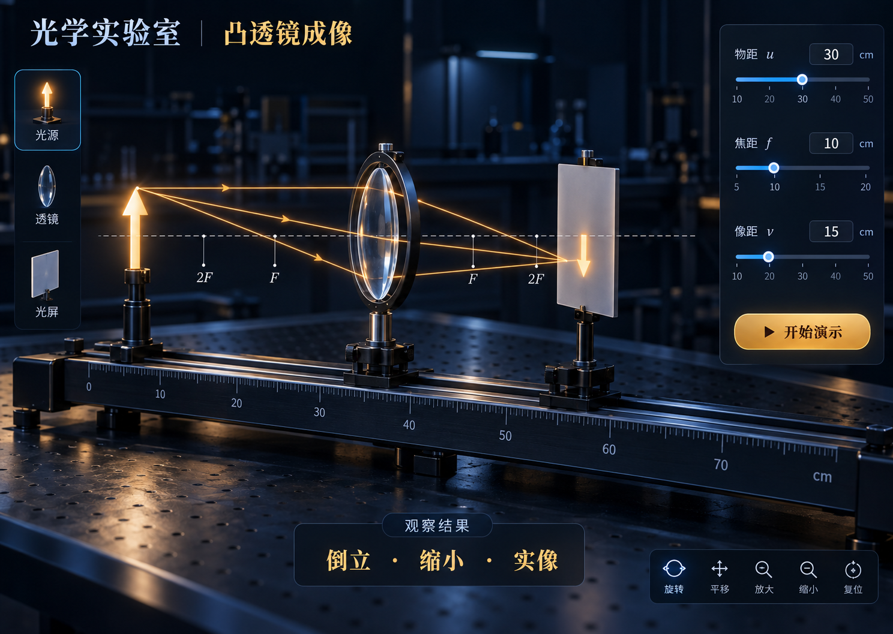

# physics-3d-courseware

用于制作和批量扩展 3D 物理交互课件的 Codex 技能。把教学资料转化为可操作的三维实验，保持统一的深色实验室风格，并要求在制作前校对物理原理、制作后验证计算和实际交互。



上图是视觉参考，不是运行画面。示例课件使用 Three.js 实时渲染三维仪器。

## 包含内容

- **182 条初中课件准备资料**：93 条初中核心、72 条初中定性拓展、17 条生活应用，按人教版初中物理主题整理；含教师/学生说明、开发目标、验收案例和原理校对链接。
- **6 个可运行的模板页面**：凸透镜成像、平面镜成像、凸透镜考试探究、传送带受力分析、空间磁场、杠杆平衡。
- **统一视觉和交互**：全屏自适应画布、半透明毛玻璃面板、柔和补光、金属环境反射、带动画的视角切换、阻尼缩放、课程下拉组件及高低画质切换。
- **共享三维表达**：GLSL 火苗与方向流光、金属桌面纹理、固定于仪器的 3D Tag 刻度文字。刻度数字随尺面透视与遮挡，不自动朝向相机。
- **资料检索与脚手架**：Python 脚本按关键词、分类或 ID 查询资料，并从已有模型创建课件组。

资料条目数量不等于已实现的课件数量。新课题仍需读取说明、实际核对 OpenStax 等权威资料，并单独开发及验证模型。定量计算和模型简化见 [模型与验证约定](references/model-and-validation.md)，根据班级学段选择适用的演示内容。

## 安装技能

将整个仓库放入 Codex 的技能目录，目录名保持 `physics-3d-courseware`，确保 `SKILL.md` 位于该目录根部。使用自定义 `CODEX_HOME` 时，放入其 `skills` 子目录。已有同名技能时先比较内容，避免覆盖本地修改。

默认目录的 Windows PowerShell 示例：

```powershell
git clone https://github.com/8vdpxdrv4c-dot/physics-3d-courseware.git "$env:USERPROFILE\.codex\skills\physics-3d-courseware"
```

在支持技能的 Codex 会话中使用：

```text
使用 $physics-3d-courseware，从初中资料库选择“平面镜成像”，先读取说明并核对原理，再制作可交互课件，沿用统一视觉与交互规范。
```

技能入口：[SKILL.md](SKILL.md)。视觉与操作细节：[design-and-interaction.md](references/design-and-interaction.md)。

## 运行示例

需要 Python 3.9+、Node.js 22.12+ 与 npm。以下命令在仓库根目录执行，输出目录必须为空：

```powershell
python scripts/scaffold_batch.py --output ../physics-courseware-demo --topics lens,mirror,lens-exam,conveyor,magnet,lever
cd ../physics-courseware-demo
npm ci
npm test
npm run dev -- --port 5173
```

打开终端显示的地址。`npm run build` 生成 `dist/`，`npm run preview` 预览构建结果；通过 HTTP 服务打开，不直接双击 HTML。首次安装依赖需要网络，构建后的示例不依赖外部 CDN。

| 课件 | 入口 |
| --- | --- |
| 凸透镜成像 | `/#/lens` |
| 平面镜成像 | `/#/mirror` |
| 凸透镜考试探究 | `/#/lens-exam` |
| 传送带受力分析 | `/#/conveyor` |
| 空间磁场 | `/#/magnet` |
| 杠杆平衡 | `/#/lever` |

## 查询资料

```powershell
python scripts/query_library.py --query "平面镜" --limit 3
python scripts/query_library.py --category 力学 --limit 5
python scripts/query_library.py --id 263eef83-a6eb-4a9e-beb9-fd7f2bb90f75 --audience both
```

资料正文内嵌在 `assets/knowledge-library.json` 中；也可以用 `--library` 指定同结构的 JSON 文件。查询中的来源 ID 用于追溯，课件的来源区展示实际支持物理原理的权威资料。

## 目录

```text
SKILL.md                       技能指令
agents/openai.yaml             技能展示信息
references/                    视觉、交互与模型验证规范
scripts/query_library.py       知识点检索
scripts/scaffold_batch.py      从已实现模型创建课件组
assets/knowledge-library.json  初中课件准备资料
assets/courseware-starter/     Three.js / Vite 公共模板与测试
assets/visual-reference.png    视觉方向参考
```

背景与环境反射图为 AI 生成的 LDR 全景，生成记录见 [asset-provenance.json](assets/courseware-starter/public/textures/asset-provenance.json)。它用于展示氛围，不是实测 HDR 环境。模板中的光线、火苗、磁场和静力学等模型均有明确简化边界；数值测试与构建通过仍需配合浏览器验收。
